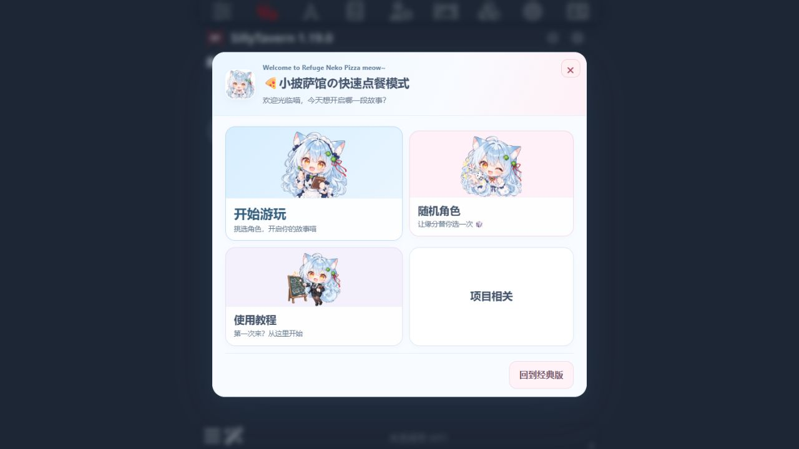

# ST-refuge · Refuge Neko Pizza

版本 **0.5.4**，适配 **SillyTavern 1.19.0 / Node.js ≥20**。

猫猫主界面、快速角色选择、聊天文件管理、聊天级 Persona、密码聊天和管理员连接保护。



## 安装方式：主机准备一次，前端通过 GitHub URL 安装

本仓库根目录有 `manifest.json`，可以直接作为酒馆“安装扩展”的 GitHub 仓库。前端代码已适配第三方扩展目录，包含用户级与全局级 HTTP 挂载路径。

**完整功能需要主机管理员安装服务端和兼容接入。** URL 安装只下载浏览器扩展，不能写入酒馆服务器的模块或核心导航。此版本采用前端扩展 + 官方服务端插件 + 经过检查的小范围兼容补丁，保留加载前选择和服务器权限检查；不是零核心修改的一键插件。

### 1. 主机管理员准备

下载本仓库，停止酒馆，在仓库目录运行：

```sh
node scripts/install.mjs --sillytavern "酒馆根目录" --check
node scripts/install.mjs --sillytavern "酒馆根目录"
```

`--check` 只检查并列出变更，不写文件。安装会：

- 检查 `package.json` 确认为 SillyTavern 1.19.0。
- 对八个核心文件应用精确上下文补丁，不复制覆盖整份 `script.js`。
- 安装 `plugins/ST-refuge` 与一个很小的 `src/chat-selector.js` 兼容桥。
- 在现有 `config.yaml` 中启用 `enableServerPlugins`，保留其他配置。
- 备份所有被改变的文件，生成可校验的卸载记录。遇到冲突先退出，不猜测覆盖。

然后重新启动酒馆。

### 2. 玩家安装前端

在酒馆“扩展程序 → 安装扩展”中输入真实仓库地址：

```text
https://github.com/你的账号/ST-refuge
```

这是地址格式示例，发布前需换为自己的账号。安装后刷新。若主机端尚未就绪，设置面板会显示安装提示，不假装密码保护已经工作。

### 无需 GitHub 的本地完整安装

```sh
node scripts/install.mjs --sillytavern "酒馆根目录" --check --with-frontend
node scripts/install.mjs --sillytavern "酒馆根目录" --with-frontend
```

前端会放在 `public/scripts/extensions/third-party/ST-refuge`。不要同时再装一个同版本的用户级副本，以免重复加载。

## 从旧的本机 0.5.3 版本迁移

对已有 `public/scripts/extensions/chat-selector` 和旧 `src/chat-selector.js` 的安装，增加 `--migrate-legacy`：

```sh
node scripts/install.mjs --sillytavern "酒馆根目录" --check --with-frontend --migrate-legacy
node scripts/install.mjs --sillytavern "酒馆根目录" --with-frontend --migrate-legacy
```

仅接受已识别的旧后端代码哈希。旧前端 manifest 会被备份并停用，防止新旧扩展同时启动；聊天、Persona、密码保险库和已有管理员设置不删除。若旧代码被其他人修改，安装器会拒绝自动覆盖。

## 默认管理员密码

新实例默认密码为 **`hsmygcs114514`**。仅在管理员配置不存在时初始化，已有密码永远不被默认值覆盖。服务器保存 `salt/hash`，前端 JS 不保存密码；聊天密码、管理员配置及 API 密钥都不随发布包附带。

这是公开的初始口令。对外提供服务前应使用独立口令；首次初始化可在启动酒馆前设置环境变量 `REFUGE_ADMIN_PASSWORD`（8～128字符），用于生成该实例自己的哈希。已有实例的配置不会因该变量被悄悄替换。

默认口令用于找回聊天密码、删除超过20楼的记录和查看/修改自定义连接。

## 功能

- **猫猫主界面**：开始游玩、随机角色、使用教程、项目相关；红叉关闭保留当前页面。
- **快速角色选择**：原生搜索、排序与标签共享，条目/图片切换，自适应分页，桌面高密度展示。
- **随机角色**：只读名称/图片/描述；再抽一次、回主界面、确认进入新建聊天。
- **聊天选择**：打开前先选已有/新建；取消保持角色、正文、指针及凭据。
- **新建聊天**：名称3～80个汉字/英文/数字，同卡不重名，JSONL与名称对应；密码按钮默认折叠。
- **聊天级 Persona**：已有身份列表、搜索与随机勾选；确认创建才写入原生 `chat_metadata.persona`，不强制绑定新角色卡。
- **聊天编辑**：改名、单字/Emoji 图标、删除确认；超过20楼再次校验管理员密码。
- **连接保护**：自定义基础URL/密钥默认隐藏；管理员短期授权后编辑，关闭/超时撤销。
- **界面与声音**：隔离样式、提供的三张按钮插画与头像、手机适配、200ms微交互、减少动态效果支持、复用酒馆消息音效。

项目相关目前是无操作占位。群聊和临时 Assistant 沿用酒馆原流程。保护基于酒馆登录账号与服务器 API；Persona 是聊天身份。JSONL正文保留原生明文格式。自定义URL仍属于原生客户端运行设置，本版不把浏览器开发者工具视作秘密隔离边界。

## 卸载 / 回滚

停止酒馆后，用安装时输出的相对记录路径：

```sh
node scripts/install.mjs --sillytavern "酒馆根目录" --uninstall "chat-selector-backups/ST-refuge-安装时间/record.json"
```

卸载先核对当前文件及备份哈希，再恢复原文件/移除新文件；不会递归删除目录，也不会删除聊天、保险库或私人管理员配置。安装后自行修改的代码会导致自动回滚拒绝，请人工合并。仅在扩展面板卸载前端，不会自动移除服务端与兼容接入。

## 开发与验证

```sh
npm install --ignore-scripts
npm test
npm run check
```

`npm run preview` 可启动仅用于UI的模拟预览（默认端口18766，演示管理员口令 `previewadmin123`）。它不是真实后端，不应用于用户服务；实际管理员默认口令仍按上文初始化。预览声音可通过 `SILLYTAVERN_ROOT` 指向测试酒馆以复用原生文件。

运行时没有额外 npm 依赖；`acorn` 仅用于开发中的真实酒馆函数兼容测试。未提供 `SILLYTAVERN_ROOT` 时，依赖酒馆源码的测试会明确跳过。完整兼容测试应指向已运行安装器的1.19.0副本：

```sh
# 在终端设置 SILLYTAVERN_ROOT 为测试酒馆目录，再运行 npm test。
```

0.5.4 已在隔离的1.19.0实例完成48项完整测试、真实服务器HTTP权限检查和浏览器前端检查；详见 [验证记录](docs/verification.md)。没有使用真实聊天或真实 API 密钥。

更多信息：[开发架构](docs/architecture.md)、[GitHub发布步骤](docs/publishing.md)、[更新记录](CHANGELOG.md)。

## 许可与素材

软件与SillyTavern衍生兼容修改采用 AGPL-3.0-only，保留上游声明，见 `LICENSE` 与 `NOTICE`。四张插画由项目持有人提供，素材授权单独说明于 [ASSETS.md](ASSETS.md)，不把软件许可自动当作第三方图片授权。
